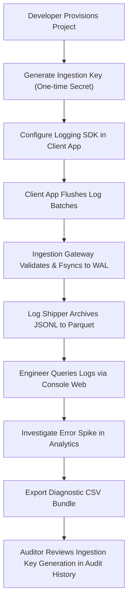

# Skyra LogHub — Canonical Functionality Specification
**Document ID:** `DOC-01-FUNC`  
**Milestone:** Q-04 Canonical Documentation Architecture  
**Status:** Authoritative / Source-Verified  
**Repository:** `skyra-log-hub`  
**Last Verified Baseline:** Node.js v24.14.0 / Angular 20 / NestJS 11 / Fastify 5

---

## 1. Executive Summary & Product Scope

Skyra LogHub is a high-performance, enterprise-grade distributed logging, ingestion, analytics, and audit platform designed for multi-tenant cloud environments. It provides:
1. **High-Throughput Ingestion:** Write-Ahead Log (WAL) backed ingestion gateway with synchronous `fsync` durability and cryptographic admission receipts.
2. **Interactive Log Exploration:** Fast search across log streams with field filtering, facet breakdowns, high-density workstation view, and detail drawers.
3. **Multi-Tenant Administration:** Strict tenant and project isolation with Role-Based Access Control (RBAC), capability projections, and immutable audit trails.
4. **Credential Lifecycle Management:** Scoped project ingestion keys with cryptographically secure generation, one-time secret revelation, and immediate revocation.
5. **Observability & Analytics:** Real-time metrics, time-series volume distributions, severity histograms, and customizable dashboard preferences.
6. **Unified Client SDKs:** Zero-dependency and idiomatic logging packages across Node.js, NestJS, Next.js, Browser, Angular, React, and Python.

---

## 2. User Personas

| Persona | Primary Responsibilities | Default Roles & Capabilities | Core Workflows |
| :--- | :--- | :--- | :--- |
| **Platform / Organization Owner** | Organization lifecycle, billing, tenant settings, root governance | `TENANT_OWNER` (`*` capabilities) | Tenant rename, member invitation, role promotion, quota expansion |
| **Project Administrator** | Project provisioning, team access, API credentials, quota management | `PROJECT_ADMIN` (`project:write`, `credentials:manage`) | Generate ingestion keys, set project quotas, configure saved searches |
| **DevOps / SRE Engineer** | Application deployment, pipeline integration, infrastructure debugging | `PROJECT_MEMBER` (`logs:read`, `credentials:read`) | Deploy SDKs, investigate incidents via Explorer, export diagnostic bundles |
| **Security / Compliance Auditor** | Governance review, credential access audits, access tracking | `AUDITOR` (`audit:read`, `logs:read`, `quotas:read`) | Review audit logs, inspect revoked credentials, verify compliance exports |
| **Read-Only Viewer / Developer** | Application telemetry review, basic querying | `VIEWER` (`logs:read`, `analytics:read`) | Search logs, view analytics dashboards, inspect error traces |

---

## 3. Core Feature Inventory & Specifications

### 3.1 Organization & Tenant Management
- **Purpose:** Authoritative boundary for all users, projects, quotas, and billing.
- **User Roles:** `TENANT_OWNER` (write), all members (read).
- **Supported Operations:**
  - View organization details (ID, display name, created at, status).
  - Update display name with optimistic concurrency control (`ETag` / `If-Match`).
  - View organization member roster and pending invitations.
- **Input / Output Behavior:**
  - Input: Name string (1-100 characters).
  - Output: Tenant model with microsecond timestamps and concurrency version.
- **Relevant APIs:**
  - BFF: `GET /bff/organization`, `PATCH /bff/organization`.
  - Admin Service (Internal): `GET /admin/v1/tenants/:tenantId`, `PATCH /admin/v1/tenants/:tenantId`.
- **Relevant UI Modules:** `apps/console-web/src/app/features/organization`.
- **Backend Authority:** `apps/admin-service` (`TenantModule`, `PrismaTenantRepository`).
- **Security Considerations:** Strict tenant isolation; cross-tenant updates are physically prohibited at database repository and controller guards.
- **Known Limits:** Multi-organization switching for single identity is bound to active session state.

### 3.2 Authentication & Membership Lifecycle
- **Purpose:** Secure identity federation via OpenID Connect (OIDC) with durable, encrypted cookie sessions.
- **User Roles:** All authenticated identities; `TENANT_OWNER` / `ADMIN` for invitations.
- **Supported Operations:**
  - OIDC PKCE login flow (Enterprise SSO / Microsoft Entra ID External ID).
  - Session verification (`/bff/session`).
  - Switch active tenant / project.
  - Invite new members by email with role assignment (`OWNER`, `ADMIN`, `MEMBER`, `VIEWER`).
  - Update member roles with confirmation modal and ETag concurrency.
  - Revoke membership and cancel invitations.
  - Explicit logout with server-side session revocation.
- **Input / Output Behavior:**
  - Input: Email address, target role enum.
  - Output: Signed invitation record / updated membership projection.
- **Relevant APIs:**
  - BFF: `GET /bff/auth/login`, `GET /bff/auth/callback`, `GET /bff/session`, `POST /bff/auth/logout`, `GET /bff/workspaces`, `POST /bff/workspaces/select`.
  - BFF Members: `GET /bff/organization/members`, `POST /bff/organization/members/invite`, `PATCH /bff/organization/members/:userId/role`, `DELETE /bff/organization/members/:userId`.
  - Admin Service (Internal): `GET /admin/v1/tenants/:tenantId/members`, `POST /admin/v1/tenants/:tenantId/members/invite`, `PATCH /admin/v1/tenants/:tenantId/members/:userId/role`, `DELETE /admin/v1/tenants/:tenantId/members/:userId`.
- **Relevant UI Modules:** `apps/console-web/src/app/features/login`, `apps/console-web/src/app/features/organization`.
- **Backend Authority:** `apps/console-bff` (Session handling & OIDC) and `apps/admin-service` (IAM & Membership).
- **Security Considerations:** Sessions stored in PostgreSQL encrypted with AES-256-GCM. Anti-CSRF double-submit cookies enforced on all state-changing endpoints.

### 3.3 Project Lifecycle & Managed Ingestion Credentials
- **Purpose:** Logical isolation unit for application log streams within a tenant.
- **User Roles:** `TENANT_OWNER`, `PROJECT_ADMIN`.
- **Supported Operations:**
  - Provision project with kebab-case identifier (e.g., `payment-service-prod`).
  - Update project name, description, and status (`ACTIVE`, `ARCHIVED`).
  - Generate managed ingestion credentials (`skyra_live_<64_hex>`).
  - Display raw secret key **exactly once** in a secure modal with copy-to-clipboard.
  - Revoke active credentials with immediate invalidation at Gateway.
- **Input / Output Behavior:**
  - Create: `{ name: string, projectId: string, description?: string }`.
  - Credential Create Output: `{ id: string, name: string, maskedKey: string, secretKey: string, createdAt: string }` (masked key format: `skyra_live_...e4f2`).
- **Relevant APIs:**
  - BFF Projects: `GET /bff/projects`, `POST /bff/projects`, `PATCH /bff/projects/:id`.
  - BFF Credentials: `GET /bff/projects/:projectId/credentials`, `POST /bff/projects/:projectId/credentials`, `DELETE /bff/projects/:projectId/credentials/:id`.
  - Admin Service (Internal): `GET /admin/v1/tenants/:tenantId/projects`, `POST /admin/v1/tenants/:tenantId/projects`, `PATCH /admin/v1/tenants/:tenantId/projects/:projectId`.
  - Admin Service Credentials (Internal): `GET /admin/v1/tenants/:tenantId/projects/:projectId/credentials`, `POST /admin/v1/tenants/:tenantId/projects/:projectId/credentials`, `DELETE /admin/v1/tenants/:tenantId/projects/:projectId/credentials/:credentialId`.
- **Relevant UI Modules:** `apps/console-web/src/app/features/projects`, `apps/console-web/src/app/features/credentials`.
- **Backend Authority:** `apps/admin-service` (`ProjectModule`, `CredentialModule`).
- **Security Considerations:** Secret keys hashed with SHA-256 before persistence; unhashed keys are never written to disk or database.

### 3.4 Ingestion Pipeline & Durable WAL Admission
- **Purpose:** High-throughput, reliable admission of structured logs from client applications.
- **User Roles:** Authenticated applications bearing valid project ingestion token.
- **Supported Operations:**
  - Batch ingestion of canonical log events (up to 500 events or 2 MB per batch).
  - Validation against Canonical Log Schema v1.
  - Atomic Write-Ahead Log (WAL) append with synchronous `fsync` flush.
  - Return of cryptographic admission receipt containing `batchId`, `walOffset`, and `timestamp`.
  - Strict deduplication of repeated `eventId` submissions.
- **Input / Output Behavior:**
  - Input: HTTP POST with `Authorization: Bearer <skyra_live_<64_hex>>` and JSON batch payload.
  - Output: `200 OK` with `{ status: "durably_accepted", batch_id: string, accepted_count: number, duplicate: boolean, receipt: { receipt_id, journal_segment, journal_offset, committed_at, content_digest } }` or RFC 7807 error.
- **Relevant APIs:** `POST /ingest/v1/logs` (`apps/ingestion-gateway`).
- **Relevant UI Modules:** Monitored via Analytics and Quotas views.
- **Backend Authority:** `apps/ingestion-gateway`.
- **Security Considerations:** Rate-limited and quota-checked before disk write. Token validation cache avoids database stampede.

### 3.5 Log Explorer, Query Engine & Detail Drawer
- **Purpose:** Interactive exploration, filtering, and debugging of ingested log events.
- **User Roles:** All project members with `logs:read` capability.
- **Supported Operations:**
  - Text search and structured filter syntax (`service:api AND level:error`).
  - Time range selector (Presets: 15m, 1h, 24h, 7d; Custom ISO timestamps).
  - Dynamic severity badges with ECS normalization (`trace`, `debug`, `info`, `warn`, `error`, `fatal`).
  - Facet distribution sidebar (counts by service, environment, host, severity).
  - High-density workstation data table with virtual scrolling support.
  - Slide-out detail drawer displaying full JSON payload, stack trace, and metadata.
  - Direct export of filtered results to CSV or JSON via `triggerBlobDownload`.
- **Input / Output Behavior:**
  - Query: `{ query: string, startTime: string, endTime: string, limit: number, cursor?: string }`.
  - Response: `{ events: LogEvent[], nextCursor?: string, totalEstimated: number }`.
- **Relevant APIs:**
  - BFF: `POST /bff/query/search`, `GET /bff/query/facets`, `GET /bff/query/events/:id`, `POST /bff/query/export`.
  - Query Service (Internal): `POST /query/v1/logs/search`, `POST /query/v1/logs/facets`, `GET /query/v1/logs/events/:id`.
- **Relevant UI Modules:** `apps/console-web/src/app/features/log-explorer`.
- **Backend Authority:** `apps/query-service` (DuckDB columnar query engine on Parquet archives).
- **Security Considerations:** Tenant and project scoping automatically injected by BFF proxy; clients cannot query outside their active context.

### 3.6 Saved Searches & Workspace Preferences
- **Purpose:** Reusable investigation queries and personalized workspace configuration.
- **User Roles:** Authenticated project users.
- **Supported Operations:**
  - Save current explorer query, filters, and time presets under a memorable name.
  - Recall saved search from dropdown with instant execution.
  - Delete obsolete saved searches.
  - Store dashboard preferences (widget layout, default refresh intervals).
- **Relevant APIs:**
  - BFF: `GET /bff/projects/:projectId/saved-searches`, `POST /bff/projects/:projectId/saved-searches`, `DELETE /bff/projects/:projectId/saved-searches/:id`, `GET /bff/projects/:projectId/dashboard-preferences`, `PUT /bff/projects/:projectId/dashboard-preferences`.
- **Relevant UI Modules:** `apps/console-web/src/app/features/log-explorer`, `apps/console-web/src/app/features/settings`.
- **Backend Authority:** `apps/console-bff` / `apps/admin-service`.

### 3.7 Analytics & Workstation Visualizations
- **Purpose:** Aggregated observability into log volumes, failure spikes, and service health.
- **User Roles:** All authenticated users.
- **Supported Operations:**
  - Summary metric cards (Total Ingested, Error Rate, Active Services, Storage Volume).
  - Time-series log volume histogram with bucket-click zoom into Explorer.
  - Severity distribution breakdown chart.
  - Keyboard accessible data table toggle for all charts.
- **Relevant APIs:**
  - BFF: `POST /bff/query/dashboard`.
  - Query Service (Internal): `POST /query/v1/logs/dashboard`, `POST /query/v1/logs/aggregate`.
- **Relevant UI Modules:** `apps/console-web/src/app/features/analytics`.
- **Backend Authority:** `apps/query-service`.

### 3.8 Quota Management & Admission Accounting
- **Purpose:** Prevent resource exhaustion and enforce multi-tenant fair-share ingestion policies.
- **User Roles:** `TENANT_OWNER`, `PROJECT_ADMIN` (write), all members (read).
- **Supported Operations:**
  - View daily and monthly quota utilization meters.
  - Configure project-level rate limits (events/sec) and daily volume limits (MB/day).
  - Real-time admission enforcement at Ingestion Gateway (`429 Too Many Requests`).
- **Relevant APIs:**
  - BFF: `GET /bff/projects/:projectId/quota`, `PATCH /bff/projects/:projectId/quota`, `GET /bff/projects/:projectId/usage`, `GET /bff/projects/:projectId/usage/history`.
  - Admin Service (Internal): `GET /admin/v1/tenants/:tenantId/projects/:projectId/quota`, `PATCH /admin/v1/tenants/:tenantId/projects/:projectId/quota`, `GET /admin/v1/tenants/:tenantId/projects/:projectId/usage`.
- **Relevant UI Modules:** `apps/console-web/src/app/features/quotas`.
- **Backend Authority:** `apps/admin-service` (`QuotaModule`) and `apps/ingestion-gateway`.

### 3.9 Audit Trail & Governance Log
- **Purpose:** Immutable compliance record of all administrative and security-relevant actions.
- **User Roles:** `TENANT_OWNER`, `AUDITOR`.
- **Supported Operations:**
  - Chronological audit event table with microsecond precision.
  - Filter by actor, target resource, action type, and status.
  - Inspect structured change delta (before/after states).
  - Export audit logs to RFC 4180 compliant CSV.
- **Relevant APIs:**
  - BFF: `GET /bff/organization/audit`, `GET /bff/organization/audit/export`, `GET /bff/organization/audit/access`.
  - Admin Service (Internal): `GET /admin/v1/tenants/:tenantId/audit`, `GET /admin/v1/tenants/:tenantId/audit/export`.
- **Relevant UI Modules:** `apps/console-web/src/app/features/audit`.
- **Backend Authority:** `apps/admin-service` (`AuditModule`, `PrismaAuditRepository`).
- **Security Considerations:** Audit records are append-only; update and delete operations are forbidden by schema and database constraints.

### 3.10 Project Retention Policy Management
- **Purpose:** Configure raw JSONL archive and derived Parquet cache retention duration and manage compliance legal holds.
- **User Roles:** `TENANT_OWNER` (`retention.manage`), all project members (`retention.read`). Releasing legal hold requires `TENANT_OWNER` authority.
- **Supported Operations:**
  - View current archive retention period (`retentionDays` 1–365), Parquet purge preference (`enableParquetPurge`), and legal hold status (`isLegalHold`).
  - Update retention period and purge preference via `PATCH`.
  - Activate or release legal hold with explicit confirmation. When active, all automated archive deletions are suspended.
- **Relevant APIs:**
  - BFF: `GET /bff/projects/:projectId/retention`, `PATCH /bff/projects/:projectId/retention`.
  - Admin Service (Internal): `GET /admin/v1/projects/:projectId/retention`, `PATCH /admin/v1/projects/:projectId/retention`.
- **Relevant UI Modules:** `apps/console-web/src/app/features/retention`.
- **Backend Authority:** `apps/admin-service` (`RetentionService`, `RetentionController`).
- **Security Considerations:** Scoped to authorized tenant; legal hold release requires elevated organization owner authority; all mutations generate immutable `RETENTION_POLICY_CHANGED` audit records.

### 3.11 Automated Background Compaction & Parquet Materialization (BL-06 / Q-06F Hardened)
- **Purpose:** Automatically and continuously discover sealed archive JSONL segments and materialize them into columnar Apache Parquet artifacts for optimal query performance, without requiring user queries to initiate conversion.
- **User Roles:** Autonomous background system worker running within `apps/query-service`.
- **Supported Operations:**
  - Continuous segment discovery combining PostgreSQL `ArchiveSegment` catalog lookups with filesystem walk fallback.
  - Manifest cryptographic verification ensuring companion `.manifest.json` digest, record count, and schema version match prior to materialization.
  - Dual-layer distributed coordination via atomic filesystem claim files (`.claims/`) and dedicated-session PostgreSQL advisory locks (`pg_try_advisory_lock`).
  - Generational fencing tokens (`generation`) and unforgeable `claimId` ownership on every claim lease.
  - Active heartbeat lease renewal preventing long-running healthy workers from losing claims due to fixed TTL timeouts.
  - Pre-publication fencing verification (`verifyOwnership`) ensuring no superseded or stale worker can publish Parquet artifacts.
  - Safe claim release: stale workers cannot delete newer replacement claims owned by subsequent generations.
  - Mandatory fail-closed database coordination: when database coordination is configured, connection failures or lock contention fail closed immediately without unsafe file-only fallback.
  - Durable failure state tracking across process restarts (`.state/compaction-failures.json`) capping retries at `compactionMaxRetries` and preventing infinite crash loops.
  - Safe, atomic Parquet materialization using DuckDB with staging files and instant rename.
  - Automatic startup crash recovery and stale claim lease reclamation.
  - Bounded concurrency worker pools with exponential backoff on retryable failures.
  - Retention policy and legal hold compliance awareness (deferring or preserving segments marked under legal hold).
- **Supported Deployment Topologies:**
  1. *Single-Node / Standalone:* Local filesystem atomic claims (`wx`) with graceful offline fallback.
  2. *Shared Storage Multi-Instance (NFS/EFS):* Atomic filesystem claims combined with dedicated PostgreSQL advisory locks.
  3. *Separate Storage Multi-Instance:* Serialized strictly through centralized PostgreSQL advisory locks (fails closed if database coordination is unavailable).
- **Zero-Deletion Boundary:** Background compaction is strictly additive and nondestructive. Raw JSONL files, companion manifests, WAL entries, and existing Parquet artifacts are never deleted or truncated by compaction.
- **Backend Authority:** `apps/query-service` (`BackgroundCompactionService`, `CompactionDiscoveryService`, `CompactionLockCoordinatorService`).
- **Observability:** Generates structured audit events (`COMPACTION_CYCLE_STARTED`, `COMPACTION_SEGMENT_CLAIMED`, `COMPACTION_SEGMENT_COMPLETED`, `COMPACTION_SEGMENT_FAILED`, `COMPACTION_SEGMENT_RETRY`, `COMPACTION_STALE_CLAIM_RECOVERED`, `COMPACTION_LEGAL_HOLD_PRESERVED`, `COMPACTION_LOCK_COORDINATION_FAILED`, `COMPACTION_STALE_RELEASE_IGNORED`, `COMPACTION_PUBLICATION_FENCED`).

---

## 4. End-to-End User Workflows

---

## 5. Known Feature Limitations & Future Scope

### Currently Enforced System Limits
- Maximum batch size: 500 events or 2.0 MB per HTTP request.
- Maximum single log message size: 64 KB.
- Query search window: Default maximum 30 days in interactive Explorer.
- Export limit: Bounded to 50,000 events per CSV/JSON stream to protect memory.

### Unimplemented / Planned Roadmap Features (Clearly Labeled)
- *Live Tail Streaming:* Real-time WebSocket log tailing is an architectural roadmap item; current explorer relies on fast near-real-time polling against indexed Parquet/DuckDB storage.
- *Custom Alerting Rules & Webhooks:* Automated threshold alerts (Slack/PagerDuty/webhooks) are planned for future Phase 5 releases. Current system provides live query filters and analytics dashboards without background alerting daemons.
- *Cold Storage Glacier Tiering:* Automatic archival to cold S3 Glacier beyond 90 days is documented as design-only.
- *Protobuf & gRPC Ingestion Interfaces:* Ingestion currently utilizes HTTP REST with JSON/NDJSON payloads; gRPC/Protobuf ingestion interfaces are planned for future high-throughput streaming pipelines.
- *Distributed Trace Waterfall & Collector:* Log records capture and propagate W3C `trace_id` and `span_id` correlation identifiers; dedicated distributed trace collectors (OpenTelemetry) and waterfall span graph visualizations are planned future milestones.
- *Offline Persistent SDK Spooling:* Client SDKs buffer events in-memory with priority eviction on overflow; offline persistent disk spooling databases (SQLite/LevelDB) are planned for intermittent offline client scenarios.
- *Production Clustering & Orchestration:* Current release validates single-node containerized deployments; automated Kubernetes operators and multi-region clustering are planned infrastructure milestones.

