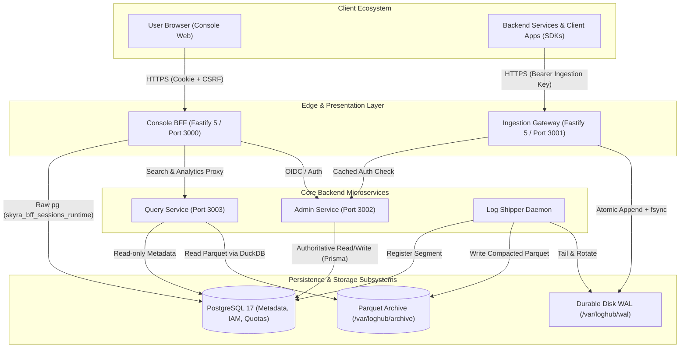
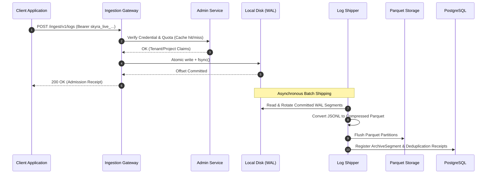
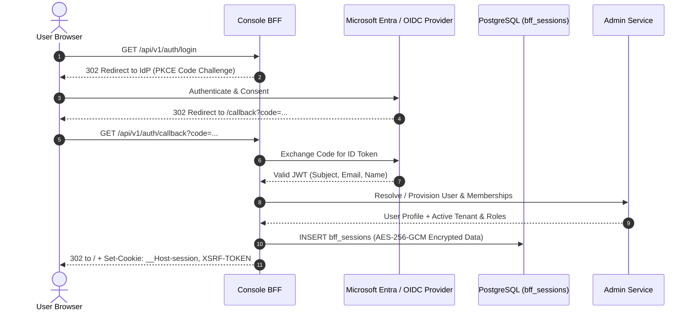
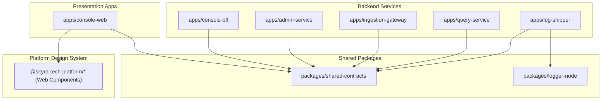
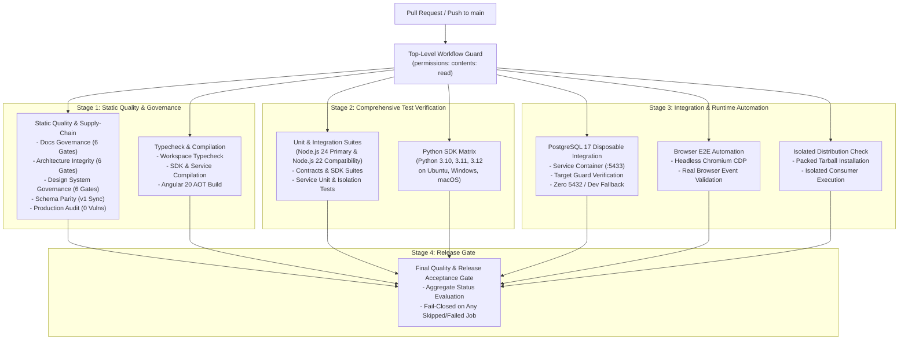

# Skyra LogHub — Authoritative Architecture Specification
**Document ID:** `DOC-02-ARCH`  
**Milestone:** Q-04 Canonical Documentation Architecture  
**Status:** Authoritative / Source-Verified  
**Repository:** `skyra-log-hub`  
**Last Verified Baseline:** Node.js v24.14.0 / Angular 20 / NestJS 11 / Fastify 5

---

## 1. Core Architectural Principles

Skyra LogHub is built upon six non-negotiable architectural tenets:
1. **Clean Architecture & Strict Layering:** Application layers adhere to Domain-Driven Design (Domain $\rightarrow$ Application $\rightarrow$ Infrastructure $\rightarrow$ API). Domain entities never depend on outer layers, frameworks, or databases.
2. **Explicit Service Boundaries & Zero Cross-App Coupling:** Monorepo applications (`apps/*`) never import from each other directly. Shared logic is encapsulated in versioned packages (`packages/*`), typed contracts (`contracts/*`), and external platform UI web components (`@skyra-tech-platform/*`).
3. **Defense-in-Depth & Least Privilege:**
   - Ingestion Gateway validates API tokens in memory/cache with zero administrative write access.
   - Console BFF has zero Prisma dependencies and uses a dedicated low-privilege PostgreSQL role (`skyra_bff_sessions_runtime`) solely for encrypted session storage.
   - Query Service connects to PostgreSQL with read-only transaction mode enforced (`default_transaction_read_only=on`).
   - Administration Service holds sole authority for IAM and metadata persistence.
4. **Durable Ingestion Before Processing:** High-speed ingestion uses an atomic Write-Ahead Log (WAL) with synchronous `fsync` flush before returning admission receipts. Processing, shipping, and indexing never block ingestion throughput.
5. **Contract-First API Design:** Canonical JSON Schemas and OpenAPI 3.1 specifications serve as the single source of truth for all network interfaces.
6. **Reactive UI State & Lifecycle Safety:** The Angular 20 Web Console utilizes Signals, Standalone Components, and strictly bounded RxJS subscriptions (`takeUntilDestroyed`, `DestroyRef`) to prevent memory leaks and zombie subscriptions.

---

## 2. Monorepo Organization & Directory Topology

```text
skyra-log-hub/
├── apps/
│   ├── console-web/         # Angular 20 SPA (Signals, Standalone, Custom Elements)
│   ├── console-bff/         # NestJS 11 / Fastify 5 BFF (OIDC PKCE, CSRF, Cookie Sessions)
│   ├── admin-service/       # NestJS 11 / Fastify 5 IAM Core (Tenants, Projects, Quotas, Audit)
│   ├── ingestion-gateway/   # NestJS 11 / Fastify 5 High-Throughput Ingestion & WAL
│   ├── query-service/       # NestJS 11 / Fastify 5 Columnar Search (DuckDB, Parquet)
│   └── log-shipper/         # Node.js WAL Flusher & JSONL-to-Parquet Compactor
├── packages/
│   ├── shared-contracts/    # Canonical Schemas, OpenAPI Specs, DTOs, Validation
│   ├── logger-node/         # Node.js Production Logging Client (Zero-dep transport)
│   ├── logger-nestjs/       # NestJS Interceptors, Middleware & Async Local Storage
│   ├── logger-next/         # Next.js App & Pages Router Integration
│   ├── logger-browser/      # Browser Client (Fetch/Beacon, Error Hook)
│   ├── logger-angular/      # Angular ErrorHandler & HTTP Interceptor
│   ├── logger-react/        # React Provider & Error Boundary Hooks
│   └── logger-python/       # Python logging.Handler Implementation
├── artifacts/
│   └── platform-packages/   # 37 Immutable Skyra Platform Web Component Tarballs
├── docs/                    # Exactly 8 Authoritative Canonical Specifications
├── scripts/                 # Governance, Schema Synchronization & Architecture Auditing
└── tests/                   # End-to-End, Security, & Integration Test Harnesses
```

---

## 3. Application & Package Responsibilities

| Subsystem | Technology Stack | Core Responsibilities | Persistence / State |
| :--- | :--- | :--- | :--- |
| **`console-web`** | Angular 20.3, TypeScript 5.8, Skyra Platform | Single Page Application; reactive signal UI, theme governance, explorer workstation, quota meters, audit table | Browser memory / LocalStorage (theme, prefs) |
| **`console-bff`** | NestJS 11.2, Fastify 5.12, `pg.Pool` | Backend-For-Frontend; OIDC authentication, cookie sessions, CSRF token validation, reverse proxy to backend APIs | PostgreSQL (`bff_sessions`, AES-256-GCM) |
| **`admin-service`** | NestJS 11.2, Fastify 5.12, Prisma 5.22 | Organization management, project provisioning, member IAM, credential hashing, quota configuration, audit history | PostgreSQL (Authoritative master schema) |
| **`ingestion-gateway`** | NestJS 11.2, Fastify 5.12 | Ingestion endpoint; bearer credential verification, quota admission, canonical schema validation, WAL `fsync` | Append-only disk WAL (`.wal`) |
| **`query-service`** | NestJS 11.2, Fastify 5.12, DuckDB 1.1 | Search and aggregate log explorer queries, time-series histogram generation, facet counts, CSV export, automated background Parquet compaction | DuckDB (in-memory) / Parquet / Read-Only Postgres |
| **`log-shipper`** | Node.js v24 daemon | Rotates WAL files and flushes edge JSONL log entries into sealed archive segments | Disk WAL $\rightarrow$ Local/S3 JSONL Archives |
| **`shared-contracts`** | TypeScript, AJV, JSON Schema Draft 2020-12 | Canonical event schema, API request/response DTOs, OpenAPI specifications, type definitions | Pure code / schemas |

---

## 4. System Architectural Diagrams

### 4.1 System Component Diagram


### 4.2 Service Communication Diagram


### 4.3 Authentication & Session Request Flow


### 4.4 Module Dependency Boundaries


---

## 5. Security & Authority Boundaries

### Tenant and Project Scoping
- All persistent resources (`User`, `Project`, `IngestionCredential`, `ProjectQuota`, `AdminAuditEvent`, `ArchiveSegment`) belong strictly to an authoritative `tenant_id`.
- Queries executed through `query-service` are rewritten to enforce `tenant_id = :session_tenant AND project_id = :session_project` in the DuckDB SQL WHERE clause. No client-supplied SQL or unrestricted table access is exposed.

### Database Connection Boundaries
- **Admin Service:** Authoritative read/write connection pool using Prisma with the `skyra_admin_runtime` role.
- **Console BFF:** Zero Prisma dependencies. Direct raw `pg.Pool` connection with the `skyra_bff_sessions_runtime` role, restricted exclusively to `bff_sessions` and `bff_login_transactions`.
- **Query Service:** Read-only connection pool using the `skyra_query_runtime` role with PostgreSQL enforcing `default_transaction_read_only=on`.

### 5.1 Background Compaction & Distributed Coordination Architecture (BL-06 / Q-06F Hardened)
- **Host Subsystem:** Runs autonomously within `apps/query-service` (`BackgroundCompactionService`), leveraging the existing embedded DuckDB engine, `DuckDbParquetConverter`, `FileParquetCatalogService`, and `ArchiveDiscoveryService`.
- **Dual-Layer Distributed Coordination & Fencing Protocol:**
  1. *Atomic Filesystem Claims & Generational Fencing:* Employs `.claims/<segment>.claim.json` files created via atomic `O_CREAT | O_EXCL` flags recording worker identity, claim UUID, and monotonic generation tokens. Lease takeovers increment generation, fencing out older workers.
  2. *Dedicated-Session PostgreSQL Advisory Locks:* Uses non-blocking session-scoped `SELECT pg_try_advisory_lock(...)` over dedicated `pg.Client` sessions held for the exact duration of the conversion. This guarantees session affinity (eliminating connection-pooling lock drift) and automatic OS/TCP lock reclamation upon worker crash.
  3. *Mandatory Fail-Closed Semantics:* When database coordination is configured, connection failures or advisory lock contention immediately fail closed without unsafe single-instance fallback.
  4. *Active Heartbeat Renewal & Pre-Publication Fencing:* Workers refresh active leases periodically during conversion. Prior to atomic Parquet publication, workers verify ownership; superseded workers are fenced out with staging artifacts cleaned up.
  5. *Safe Claim Release:* Claim deletion verifies `claimId` and `generation`; stale workers cannot delete newer replacement claims.
  6. *Durable Failure State Store:* Compaction failure counts and backoff windows are atomically persisted to `.state/compaction-failures.json`, preventing infinite crash loops on process restart.
- **Fail-Safe Crash Recovery:** Stale claims exceeding lease TTL (default 15 minutes) are safely reclaimed with audit tracking. Orphaned staging files (`.staging-*.parquet`) are pruned during application bootstrap.
- **Retention & Legal Hold Awareness:** Respects `ProjectRetention` configurations. When legal hold is active (`isLegalHold = true`), segments can be safely compacted into Parquet format for query efficiency while pruning is strictly forbidden; or compaction can honor `compactionDeferLegalHold` configuration.
- **Strict Non-Destructive Invariant:** Background compaction is strictly additive; source JSONL archives, companion manifests, WAL logs, and existing Parquet artifacts are never removed or truncated.

---

## 6. Error-Handling Architecture & RFC 7807

All HTTP APIs throughout Skyra LogHub return RFC 7807 Problem Details for all 4xx and 5xx responses:
```json
{
  "type": "https://loghub.skyra.tech/errors/quota-exceeded",
  "title": "Project Ingestion Quota Exceeded",
  "status": 429,
  "detail": "Project 'payment-prod' has exceeded its daily allocation of 500000 events.",
  "instance": "/ingest/v1/logs",
  "code": "QUOTA_EXCEEDED",
  "timestamp": "2026-11-20T15:00:00.123456Z"
}
```

---

## 7. Lifecycle & Graceful Shutdown

Every backend service implements explicit `OnModuleDestroy` and process signal handling (`SIGTERM`, `SIGINT`):
1. **Fastify Server:** Stop accepting incoming connections (`app.close()`).
2. **In-Flight Requests:** Await active request drain (bounded by a 10-second timeout).
3. **Database Connections:** Gracefully close `PrismaClient` or `pg.Pool` (`$disconnect()` / `pool.end()`).
4. **WAL Flush:** Ingestion Gateway flushes all pending file descriptors and syncs directory entries.
5. **Memory Sanitization:** Crypto keys and session buffers are explicitly zeroed out (`buffer.fill(0)`).

---

## 8. Continuous Integration & Quality Enforcement Architecture (Milestone Q-05)

Skyra LogHub enforces automated quality gates prior to merging code into primary branches via GitHub Actions (`.github/workflows/sdk-verification.yml`).



### Architectural Principles of the CI Pipeline
1. **Zero Secret Exposure & Least Privilege:** Default workflow permissions are locked to `contents: read`. No administrative repository or deployment tokens are permitted.
2. **Immutable Action Pinning:** Third-party GitHub Actions are pinned to full 40-character commit SHAs with version comments for supply-chain integrity.
3. **Target Isolation & Database Guarding:** CI database tests run strictly against disposable service containers mapped to port `5433`. The target guard library (`scripts/lib/isolated-target.mjs`) throws an immediate fatal error if port `5432` or database `skyra_loghub_dev` is targeted.
4. **Aggregate Required-Status Gate:** The `final-quality-gate` job evaluates all upstream jobs using GitHub Actions dependency semantics, preventing silent failures or skipped checks from masking defects.
