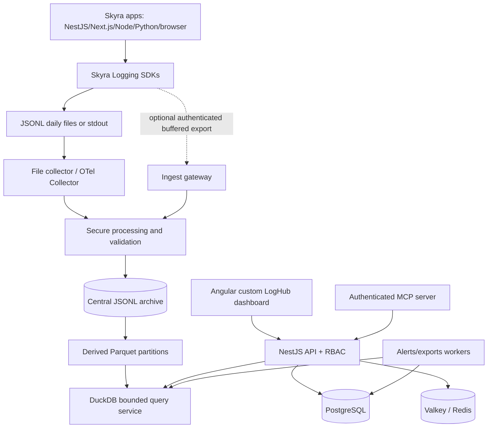
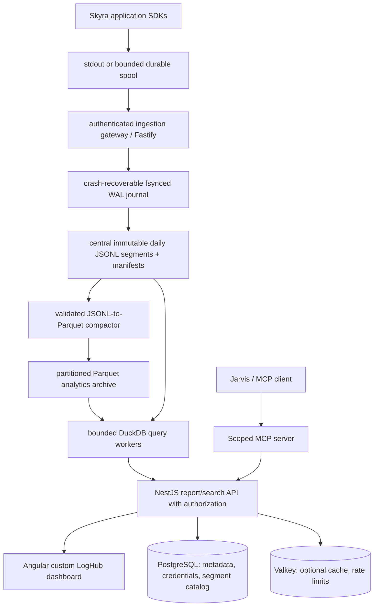

# System Architecture Document

> **Product:** Skyra LogHub  |  **Status:** Proposed baseline — review before implementation  |  **Version:** 0.1-draft  |  **Date:** 2026-10-21
> **Repository:** `skyra-loghub` (renamed by project owner). Assumptions and undecided items are marked **TBD**. These documents are design specifications, not assertions that code already exists.

## 1. Architectural style
Modular monorepo, separately deployable applications, portable infrastructure; domain boundaries distinguish **SDK/agent**, **ingestion**, **search API**, **dashboard**, **MCP**, **management metadata**, and **analytics workers**. No dashboard UI dependency for SDKs, and no public access to archived files or query workers.

## 2. High-level data flow

Browser logging must use same-origin/approved sanitized intake and cannot embed trusted service credentials. SDK writes and network exporters must not synchronously block application requests.

## 3. Technology decisions
| Concern | Choice | Rationale |
|---|---|---|
| Dashboard | Angular standalone components, strict TS, Signals, RxJS | Structured long-lived internal UI |
| UI foundation | Versioned `@skyra-tech-platform/*` Web Components | Avoid duplicate controls and styles |
| Dashboard API | NestJS + OpenAPI, DTO validation | Consistent authorization/domain modules |
| SDK (JS/TS) | Pino, thin Skyra wrappers/adapters | JSON performance and familiar ecosystem |
| SDK (Python) | standard logging with JSON formatter + optional Loguru adapter | Native ecosystem and interoperability |
| Log transport | OTel Collector filelog/OTLP where supported; optional secure gateway | Both file and direct ingress |
| Analytical log data | central JSONL archive + Parquet + DuckDB | Search/aggregations, custom UI |
| Management DB | PostgreSQL + Prisma | Accounts, memberships, tokens metadata, saved views |
| Rate limits/queue | Valkey or Redis, chosen after BullMQ compatibility test | Shared rate counters and workers |
| Visualization | Apache ECharts | Histogram and performance charts |
| MCP | TypeScript MCP SDK, HTTP OAuth for remote clients | Authorized operational tools |
| Runtime | Linux containers, Compose pilot | AWS/Azure/on-prem portability |

## 4. Logical monorepo layout (proposed, not implemented)
```text
skyra-loghub/
  apps/
    dashboard/             # Angular
    api/                   # NestJS management/search/auth
    ingest-gateway/        # isolated ingest trust boundary
    worker/                # notifications/exports
    mcp-server/            # read-only tools
  packages/
    logger-core/           # runtime-neutral TS interfaces, no DOM/server imports
    logger-node/           # Pino, filesystem, transport
    logger-nestjs/         # interceptor/filters
    logger-nextjs/         # server adapter
    logger-browser/        # sanitized frontend events
    logger-python/         # pyproject.toml, Python-native logger
    api-client/            # generated typed client
    shared-types/          # generated schema types
    config/                # tooling presets
  contracts/               # pinned generated copy from skyra-service-contracts
  infrastructure/
    compose/ collectors/ archive/ parquet/ duckdb/ reverse-proxy/
    aws/ azure/ self-hosted/
  tests/ integration/ security/ e2e/ load/
  examples/ nestjs/ nextjs/ python-fastapi/ browser/
  docs/  .github/workflows/
  pnpm-workspace.yaml turbo.json package.json
```
Python has separate interpreter/uv or equivalent workflows and must not be compiled with `pnpm`/`tsup`. Do not duplicate canonical schema ownership: `skyra-service-contracts` is authoritative **unless approved ADR revises this**; pin a tagged version in this repository.

## 5. Runtime trust boundaries
1. **App host:** local file owner and collector; unprivileged runtime; path derived from registered IDs, not unsanitized user input.
2. **Ingestion perimeter:** mTLS or service credential authentication; request size, TPS and payload validation; accept only assigned project IDs; no shared omnipotent key.
3. **Search/admin perimeter:** OIDC-backed employee sessions; per-request DB-backed membership check; allowlisted available schema fields; resource budgets.
4. **MCP perimeter:** validated OAuth client and delegated identity; read-only least-privilege tools; filtered outputs; all calls audited.
5. **Data stores:** private networks; archive/query-service credentials per purpose; DB least privilege; no direct browser access.

## 6. Host file convention
```text
${LOG_ROOT}/${PROJECT_ID}/${ENVIRONMENT}/${SERVICE_NAME}/${INSTANCE_ID}/YYYY-MM-DD.jsonl
${LOG_ROOT}/${PROJECT_ID}/${ENVIRONMENT}/${SERVICE_NAME}/${INSTANCE_ID}/YYYY-MM-DD.001.jsonl
```
Use UTC clock. Separate instance directories avoid conflicting processes across pods/hosts. For serverless/ephemeral platforms use stdout or export; collector/container must be configured for host log access. Enforce path traversal rejection, bounded disk usage, secure permissions, fsync policy and rotation/retention tests.

## 7. Data domains
- **Central JSONL archive and derived Parquet:** original event segments live in central files/object storage; generated Parquet enables analytics. DuckDB reads authorized manifests; no event database.
- **PostgreSQL:** `projects`, `services`, `environments`, `identities`, `memberships`, `credentials`, `saved_searches`, `alert_rules`, `audit_events`, `ingestion_sources`; normalized migrations.
- **Valkey/Redis:** distributed throttles, ephemeral caching, queue state, token lookup cache with immediate invalidation on revocation.
- **Object storage (optional later):** archival/export packages; encrypt, expire and authorize downloads.

## 8. Search path
Angular sends structured query AST and scope (`projectId`, time range). API reads principal, resolves authorized project/environment, builds bounded, parameterized DuckDB query plans, restricts operations/fields, executes and returns rows, histogram, field metadata, warnings and timed execution. Skyra Query Language: only support verified allowlisted operations and ensure scope is enforced **outside user-editable query text**; unsupported commands fail closed. No direct arbitrary Skyra Query Language pass-through.

## 9. Metrics and traces
Keep logs, metrics, traces distinct. Structured logs include `trace.id`/`span.id`; API/DB timings captured in metrics with low-cardinality labels. Full trace waterfall is deferred until trace storage/ingestion is selected. ECS `event.duration` uses nanoseconds. DB client elapsed != DB server execution time.

## 10. Cross-repository integration
Skyra Platform packages installed via private registry/versioned releases; no sibling-relative filesystem links in production. Issues in shared UI component are fixed in Skyra Platform, regression-tested and published, then consumed via version bump. `skyra-service-contracts` versions are pinned with compatibility verification.

## 11. Deployment profiles
- **Local:** Docker Compose services, mock OIDC or local dev provider, synthetic logs, private networks.
- **Single VM pilot:** reverse proxy, container services, encrypted persistent volumes, off-host backups, explicit non-HA disclaimer.
- **Cloud production:** independent compute and storage, managed PostgreSQL optional, private networking, load balancing, secrets management, snapshots, observed capacity and HA design.
- Avoid provider-specific SDK coupling in core code; use Terraform/IaC later if selected.

## 12. Failure recovery and risk decisions
Use bounded queues/async writes, rotating files, collector checkpoints and backpressure. Define delivery as **at-least-once where collector/retry behavior permits**, requiring event-ID dedupe strategy; no exactly-once claim. Schema conversion/validation errors go to quarantined secured dead-letter records. Monitor ingest lag, dropped logs, disk space, queue saturation, archive/conversion failures, query latency and collector health.

## 13. Decisions awaiting ADR
OIDC provider, archive partition and manifest design, token verification design, query language subset, retention/security immutability model, broker/Valkey selection, alert delivery and HA topology.


## File-first, report-first storage architecture (2026-10-24 revision)

- **Storage contract:** source archive is partitioned by `${ARCHIVE_ROOT}/${TENANT_ID}/${PROJECT_ID}/${ENVIRONMENT}/${SERVICE_NAME}/${YYYY-MM-DD}/segment-${PART_INDEX}.jsonl` with companion `.manifest.json`. Write segments via single-writer ingestion archiver with atomic finalize/manifest; avoid concurrent app writes to same archive object. Protect archive from modification and define retention/backups.
- **Centralization:** application host spool is transient, configurable and bounded; no requirement to keep permanent host copies. Serverless apps use stdout or async export. Agents/SDKs retry with checkpoints; ingress authenticates source and derives tenant/project identity server-side.
- **Durability & Idempotency:** Ingestion returns `durably_accepted` only after atomic journal write and fsync. Deduplication is authoritative via journal-backed state; Valkey is strictly an optional acceleration cache.
- **Archive backends:** filesystem/local volume or S3/Azure Blob/object-compatible provider chosen via storage adapter. Parquet partitions are generated with schema evolution controls, column/row-group statistics and sensible file sizes to avoid too many tiny files. Failed conversion must not delete original JSONL.
- **Query service:** isolated DuckDB execution workers with controlled concurrency, fixed archive roots, read-only credentials, SQL generated only from a validated report/search AST, per-request budgets/timeouts and project-scoped file manifest resolved server-side. No arbitrary path globs or user SQL. Guard against stale caches and query results crossing permissions.
- **Report acceleration:** metadata/manifest pruning by project/service/date, partition pruning, column projection, derived rollups for frequently used reports and versioned cache invalidation on finalized segments. Full-text search limitations of DuckDB remain a benchmark risk; add Tantivy only if measured requirements require it.
- **Admin DB:** PostgreSQL is NOT a log events store. Entities may include users, projects, memberships, credentials, saved reports/queries, report execution metadata, file manifests, retention policies, deduplication receipts and administrative audit records; never duplicate raw application diagnostic events.
- **Sizing:** 1 current / 5–10 future LogHub operators; application end-user counts independent and potentially large. Prioritize ingest volume and report workloads over dashboard seats.
