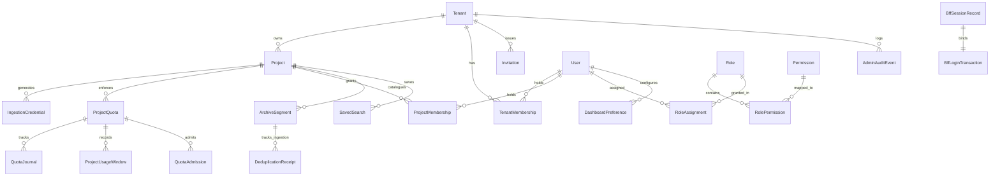

# Skyra LogHub — Database Architecture & Data Model
**Document ID:** `DOC-03-DATA`  
**Milestone:** Q-04 Canonical Documentation Architecture  
**Status:** Authoritative / Source-Verified  
**Repository:** `skyra-log-hub`  
**Last Verified Baseline:** PostgreSQL 17 / Prisma 5.22 / DuckDB 1.1

---

## 1. Architectural Role of PostgreSQL

PostgreSQL 17 serves as the single authoritative source of truth for:
1. **Multi-Tenant Hierarchy:** Organizations (`Tenant`), Projects, and metadata.
2. **Identity & Access Management (IAM):** Users, memberships, roles, permissions, and invitations.
3. **Security Credentials:** Scoped, SHA-256 hashed API ingestion keys.
4. **Ingestion Quotas & Accounting:** Quota policies, admission reservations, and usage windows.
5. **Durable Session State:** Encrypted BFF session store and OIDC state transactions.
6. **Archive Discovery Catalog:** Parquet segment manifests, file paths, min/max timestamps, and event deduplication receipts.
7. **Compliance Audit Trail:** Immutable, append-only security and administrative audit events.

> [!IMPORTANT]
> The primary database does **NOT** store high-volume raw log event payloads. Raw logs are admitted to disk WAL, compacted into columnar Parquet archives, and queried via DuckDB. PostgreSQL stores strictly metadata, indexes, and segment catalogs.

---

## 2. Schema Ownership & Service Access Matrix

| Database Role | Owned Tables / Grants | Accessing Subsystem | Connection Tech | Permissions |
| :--- | :--- | :--- | :--- | :--- |
| **`skyra_admin_runtime`** | `Tenant`, `Project`, `User`, `*Membership`, `Role*`, `Invitation`, `ProjectQuota`, `AdminAuditEvent` | `admin-service` | Prisma ORM | `SELECT`, `INSERT`, `UPDATE`, `DELETE` |
| **`skyra_bff_sessions_runtime`** | `bff_sessions`, `bff_login_transactions` | `console-bff` | Raw `pg.Pool` | `SELECT`, `INSERT`, `UPDATE` (revocation), `DELETE` |
| **`skyra_query_runtime`** | `ArchiveSegment`, `Project`, `Tenant`, `SavedSearch`, `DashboardPreference` | `query-service` | Prisma ORM | `SELECT` ONLY (`default_transaction_read_only=on`) |
| **`skyra_ingestion_runtime`** | `IngestionCredential`, `ProjectQuota`, `QuotaAdmission`, `DeduplicationReceipt` | `ingestion-gateway`, `log-shipper` | Prisma ORM | `SELECT`, `INSERT` (Receipts) |

---

## 3. Entity-Relationship Diagram (ERD)

---

## 4. Complete Authoritative Model Inventory

### 4.1 Tenancy & Projects
- **`Tenant`:**
  - `id` (UUIDv4 PK), `code` (Unique slug), `displayName` (VarChar), `status` (`ACTIVE`, `SUSPENDED`, `ARCHIVED`), `version` (Concurrency Int), `createdAt`, `updatedAt`.
  - Enforces strict tenant separation.
- **`Project`:**
  - `id` (VarChar PK, kebab-case, e.g. `auth-api-prod`), `tenantId` (FK $\rightarrow$ `Tenant.id`), `name` (VarChar), `description` (Text), `status` (`ACTIVE`, `ARCHIVED`), `retentionDays` (Int, default 30), `createdAt`, `updatedAt`.
  - Indexes: `[tenantId, status]`, `[tenantId, name]`.

### 4.2 IAM, RBAC & Membership
- **`User`:**
  - `id` (UUIDv4 PK), `externalSubject` (Unique OIDC sub), `email` (Unique VarChar), `name` (VarChar), `status` (`ACTIVE`, `DEACTIVATED`), `lastLoginAt`, `createdAt`, `updatedAt`.
- **`TenantMembership`:**
  - `id` (UUIDv4 PK), `tenantId` (FK), `userId` (FK), `status` (`ACTIVE`, `INVITED`, `SUSPENDED`), `version` (Int), `createdAt`, `updatedAt`.
  - Unique Constraint: `@@unique([tenantId, userId])`.
- **`ProjectMembership`:**
  - `id` (UUIDv4 PK), `projectId` (FK), `userId` (FK), `role` (Enum), `createdAt`, `updatedAt`.
  - Unique Constraint: `@@unique([projectId, userId])`.
- **`Role` & `Permission`:**
  - `Role`: `id`, `name` (`TENANT_OWNER`, `PROJECT_ADMIN`, `MEMBER`, `VIEWER`), `description`, `isSystem`.
  - `Permission`: `id`, `action` (`logs:read`, `credentials:manage`, etc.), `resource`.
  - `RolePermission`: Many-to-many join with unique constraint `@@unique([roleId, permissionId])`.
  - `RoleAssignment`: Binds `Role` to `User` scoped to `Tenant` or `Project`.
- **`Invitation`:**
  - `id` (UUIDv4 PK), `tenantId` (FK), `email`, `roleId`, `tokenHash` (SHA-256), `expiresAt`, `acceptedAt`, `revokedAt`.

### 4.3 Ingestion Credentials & Security Keys
- **`IngestionCredential`:**
  - `id` (UUIDv4 PK), `projectId` (FK), `name` (VarChar), `keyHash` (SHA-256 hex string), `maskedKey` (`sk_live_...4a2b`), `scopes` (Text array), `status` (`ACTIVE`, `REVOKED`), `lastUsedAt`, `expiresAt`, `createdAt`, `revokedAt`.
  - Unique Constraint: `@@unique([keyHash])`.
  - Indexes: `[projectId, status]`.

### 4.4 Quota Accounting & Admission Controls
- **`ProjectQuota`:**
  - `id` (UUIDv4 PK), `projectId` (Unique FK), `maxEventsPerSecond` (Int), `maxBytesPerDay` (BigInt), `monthlyVolumeQuotaBytes` (BigInt), `warningThresholdPercent` (Int, default 80), `enforcementPolicy` (`REJECT_429`, `DROP_SILENT`, `ALLOW_OVERAGE`), `createdAt`, `updatedAt`.
- **`ProjectUsageWindow`:**
  - `id` (UUIDv4 PK), `projectId` (FK), `windowStart` (DateTime), `windowEnd` (DateTime), `admittedEvents` (BigInt), `admittedBytes` (BigInt), `rejectedEvents` (BigInt), `createdAt`.
  - Index: `[projectId, windowStart]`.
- **`QuotaAdmission`:**
  - Active reservation ledger checking in-flight token buckets before WAL write.

### 4.5 Console BFF Session Persistence
- **`BffSessionRecord` (`bff_sessions` table):**
  - `token_digest` (VarChar 64 PK - SHA-256 hex of session token).
  - `encrypted_data` (Text - AES-256-GCM serialized payload: `v1.<iv>.<tag>.<cipher>`).
  - `created_at` (Timestamp with time zone).
  - `last_activity_at` (Timestamp with time zone).
  - `absolute_expires_at` (Timestamp with time zone - max 24 hours).
  - `idle_expires_at` (Timestamp with time zone - max 30 minutes).
  - `version` (Int - concurrency counter).
  - `revoked_at` (Timestamp with time zone - nullable).
- **`BffLoginTransaction` (`bff_login_transactions` table):**
  - `state_digest` (VarChar 64 PK).
  - `encrypted_data` (Text - OIDC PKCE verifier, nonce, redirect URI).
  - `created_at`, `expires_at`, `consumed_at`.

### 4.6 Archive Discovery & Parquet Catalogs
- **`ArchiveSegment`:**
  - `id` (UUIDv4 PK), `projectId` (FK), `segmentId` (VarChar), `filePath` (VarChar - local or S3 URI), `format` (`PARQUET`), `eventCount` (Int), `byteSize` (BigInt), `minTimestamp` (DateTime), `maxTimestamp` (DateTime), `partitionDate` (Date), `status` (`ACTIVE`, `COMPACTED`, `ARCHIVED`), `createdAt`.
  - Indexes: `[projectId, partitionDate]`, `[projectId, minTimestamp, maxTimestamp]`.
- **`DeduplicationReceipt`:**
  - `id` (UUIDv4 PK), `projectId` (FK), `batchId` (VarChar), `eventId` (VarChar), `acceptedAt` (DateTime).
  - Unique Constraint: `@@unique([projectId, eventId])`.

### 4.7 Audit History & Preferences
- **`AdminAuditEvent`:**
  - `id` (UUIDv4 PK), `tenantId` (FK), `actorId` (VarChar), `actorEmail` (VarChar), `action` (VarChar), `resourceType` (VarChar), `resourceId` (VarChar), `beforeState` (JSONB), `afterState` (JSONB), `status` (`SUCCESS`, `FAILED`), `ipAddress` (VarChar), `userAgent` (Text), `timestamp` (DateTime microsecond).
  - Indexes: `[tenantId, timestamp]`, `[tenantId, resourceType, resourceId]`.
- **`SavedSearch`:**
  - `id` (UUIDv4 PK), `projectId` (FK), `userId` (FK), `name` (VarChar), `query` (Text), `timePreset` (VarChar), `createdAt`.
- **`DashboardPreference`:**
  - `id` (UUIDv4 PK), `userId` (Unique FK), `layout` (JSONB), `theme` (`DARK`, `LIGHT`, `SYSTEM`), `updatedAt`.

---

## 5. Migration History & Authoritative Ordering

Database migrations are managed via Prisma migrate and staged SQL files in strict chronological sequence:
1. `20261024000000_init_metadata`: Baseline archive segment and gateway metadata (`apps/ingestion-gateway/prisma/migrations/`).
2. `20261028000000_admin_iam_foundation` (`ADMIN-002`): Tenants, projects, users, and RBAC permission foundation.
3. `20261103000000_feature001a_audit_integrity` (`FEATURE-001A-001`): Administrative audit logging tables and immutability rules.
4. `20261103010000_feature001b_tenant_consistency` (`FEATURE-001B-001`): Tenant isolation constraints and `FEATURE-001B-002` operational runtime role grants.
5. `20261104000000_feature002_membership_integrity` (`FEATURE-002-001`): Multi-tenant membership, invitation lifecycle, and privileges (`FEATURE-002-002`).
6. `20261104010000_feature003_projects` (`FEATURE-003-001`): Project lifecycle, kebab-case ID enforcement, and privileges (`FEATURE-003-002`).
7. `20261105000000_feature004_credentials` (`FEATURE-004-001`): Scoped API ingestion keys with SHA-256 hashing and privileges (`FEATURE-004-002`).
8. `20261106000000_feature008_quotas` (`FEATURE-008-001`): Ingestion rate limits, daily volume meters, and lock authority (`FEATURE-008-003`).
9. `20261109000000_feature009_audit_read` (`FEATURE-009-001`): Microsecond-precision audit query optimization and index bounds.
10. `20261110000000_dev013_sessions` (`DEV-013-001`): Durable encrypted session persistence (`bff_sessions`, `bff_login_transactions`) and `skyra_bff_sessions_runtime` least-privilege role configuration.
11. `20261116000000_dev015_saved_searches` (`DEV-015-001`): Saved search queries and filter recall.
12. `20261116010000_dev016_dashboard_preferences` (`DEV-016-001`): User workstation dashboard layout and widget preferences.

