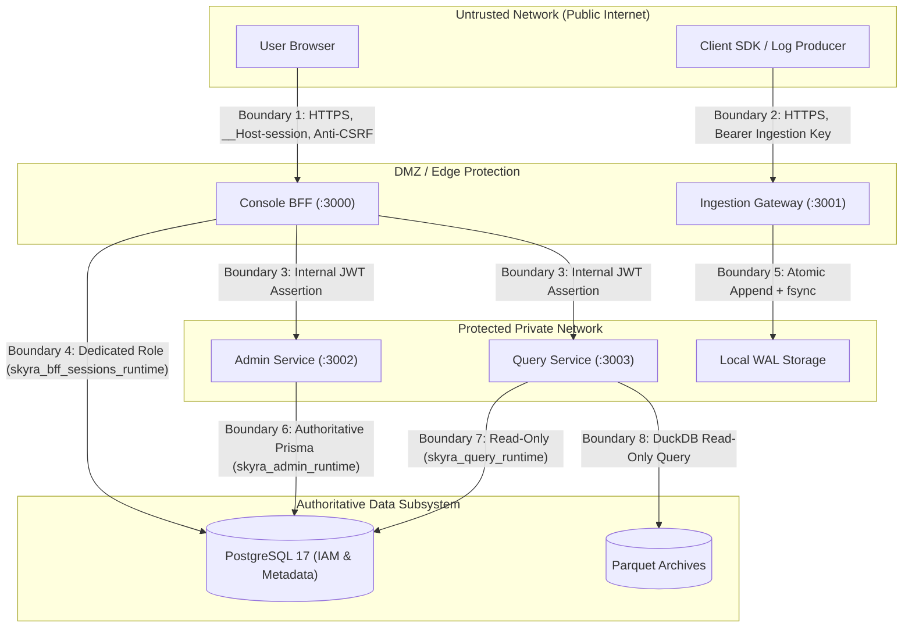

# Skyra LogHub — Security Architecture & Threat Model
**Document ID:** `DOC-05-SEC`  
**Milestone:** Q-04 Canonical Documentation Architecture  
**Status:** Authoritative / Source-Verified  
**Repository:** `skyra-log-hub`  
**Last Verified Baseline:** Node.js v24.14.0 / Fastify 5.12.8 / NestJS 11.2.11 / Angular 20.3

---

## 1. Threat Model & Trust Boundaries

The Skyra LogHub threat model is structured around STRIDE and explicit perimeter trust boundaries:



---

## 2. Authentication & Identity Management

### 2.1 Enterprise OIDC & PKCE Flow
- Authentication is federated via standard OpenID Connect (OIDC) using the Authorization Code Flow with PKCE (Proof Key for Code Exchange, S256).
- Supported identity providers include Microsoft Entra ID (Azure AD External ID) and corporate OIDC IdPs.
- The authorization code exchange occurs server-to-server within `console-bff`. Client browsers never receive or handle raw OIDC ID tokens or refresh tokens.

### 2.2 Durable Encrypted Session Persistence
- **Storage:** Persisted in PostgreSQL tables `bff_sessions` and `bff_login_transactions` via a raw connection pool (`pg.Pool`).
- **Least-Privilege Database Role:** Bound exclusively to the dedicated role `skyra_bff_sessions_runtime`. At startup, `PostgresSessionRepository` validates that the runtime user has zero superuser, create-role, create-database, or bypass-RLS permissions.
- **Cryptographic Encryption at Rest:**
  - Session payloads are encrypted with **AES-256-GCM** using an independent 256-bit data key (`SESSION_DATA_KEY`).
  - Serialized format: `v1.<iv>.<tag>.<ciphertext>`.
  - Additional Authenticated Data (AAD) is bound to `session/<token_digest>`, cryptographically preventing record-swapping or ciphertext splicing.
- **Session Lifecycle & Bounds:**
  - Idle timeout: Maximum 30 minutes of inactivity.
  - Absolute timeout: Hard cap of 24 hours.
  - Revocation: Explicit logout marks `revoked_at = clock_timestamp()`, terminating the session immediately across all active instances.

---

## 3. Web & Transport Security Controls

### 3.1 Cookie & CSRF Protections
- **Session Cookie Flags:** `__Host-session; Secure; HttpOnly; SameSite=Lax; Path=/`.
- **Anti-CSRF Protection:** Double-submit cookie pattern. The server issues a cryptographically random `XSRF-TOKEN` cookie readable by JavaScript, and the Angular Console submits it in the `X-XSRF-TOKEN` header on every state-changing request (`POST`, `PATCH`, `DELETE`). The BFF `CsrfGuard` verifies exact equality before controller execution.

### 3.2 HTTP Security Headers
Every HTTP response emitted by Fastify incorporates hardened security headers:
- `Content-Security-Policy`: `default-src 'self'; script-src 'self'; style-src 'self' 'unsafe-inline'; img-src 'self' data:; font-src 'self'; connect-src 'self'; frame-ancestors 'none';`
- `Strict-Transport-Security`: `max-age=31536000; includeSubDomains; preload`
- `X-Content-Type-Options`: `nosniff`
- `X-Frame-Options`: `DENY`
- `Referrer-Policy`: `strict-origin-when-cross-origin`

---

## 4. Multi-Tenant Authorization & IAM Boundaries

### 4.1 Role-Based Access Control (RBAC)
LogHub implements four hierarchical organizational roles:
1. **`TENANT_OWNER`:** Full authority over tenant configuration, billing, invitations, role promotions, and project deletion.
2. **`PROJECT_ADMIN`:** Full authority over project settings, quota allocation, ingestion credential creation, and saved searches.
3. **`MEMBER`:** Read access to project logs, analytics, and credentials; ability to save searches and configure personal dashboard preferences.
4. **`VIEWER`:** Strictly read-only access to log streams and dashboards; cannot view credentials or audit logs.

### 4.2 Row-Level Tenant Isolation
- Every database query for tenant-scoped resources (`Project`, `User`, `ProjectQuota`, `AdminAuditEvent`) filters explicitly on `tenant_id`.
- The BFF Query Proxy injects verified `tenant_id` and `project_id` claims into query payloads before forwarding to the Query Service. DuckDB queries on Parquet files filter on partition keys `tenant_id` and `project_id`, preventing cross-tenant data leaks.

---

## 5. Ingestion Credential & Secret Governance

1. **Format:** Project ingestion tokens adhere to the format `sk_live_<32_random_bytes_hex>`.
2. **One-Time Secret Revelation:** When an API key is created in the Web Console, the raw plaintext secret is transmitted **once** to the creator's browser inside a secure modal with an explicit copy button.
3. **Storage Security:** The database stores only the SHA-256 hash (`keyHash`) and a masked display string (`maskedKey`, e.g. `sk_live_...e4f2`). Plaintext keys are never stored on disk or in the database.
4. **Immediate Revocation:** Revoking a credential in the UI marks `status = 'REVOKED'`, which invalidates the Ingestion Gateway's memory cache within 10 seconds.

---

## 6. Preview Mode Isolation & Safeguards

To support offline local frontend validation without live OIDC identity providers, Console Web provides an opt-in Preview Mode:
- **Strictly Opt-in & Isolated:** Preview mode is disabled by default and physically prohibited when running against production-classified configuration (`production: true` in `environment.ts`).
- **Zero Synthetic Authority:** In production environments, attempting to supply preview flags or synthetic identities fails closed. Changing preview settings after initialization immediately revokes any synthetic session authority.
- **Backend Rejection:** Production backend services reject synthetic headers or non-OIDC tokens unconditionally.

---

## 7. Audit Trail & Non-Repudiation

- All administrative mutations (member invite, role change, project creation, credential generation, quota modification) generate an immutable `AdminAuditEvent`.
- Stored fields include `tenantId`, `actorId`, `actorEmail`, `action`, `resourceType`, `resourceId`, `beforeState` (JSONB), `afterState` (JSONB), `ipAddress`, `userAgent`, and a microsecond timestamp.
- The `AdminAuditEvent` table is append-only; update and delete privileges are revoked from application roles.
- CSV exports of audit logs apply RFC 4180 formula escaping (prefixing `=`, `+`, `-`, `@` with a single quote `'`) to prevent spreadsheet formula injection attacks.

---

## 8. Dependency Vulnerability Governance (Q-02 Remediation Baseline)

### 8.1 Production Advisory Status
Authoritative production vulnerability audits (`pnpm audit --prod --json`) report:
- **Critical Advisories:** 0
- **High Advisories:** 0
- **Moderate Advisories:** 0
- **Low Advisories:** 0
- **Total Production Advisories:** **0** (Exit code: 0)

### 8.2 Retained Dependency Override Justification
`pnpm-workspace.yaml` maintains one scoped override:
```yaml
overrides:
  '@nestjs/platform-fastify>fastify': '5.12.8'
```
- **Security Justification:** `@nestjs/platform-fastify@11.2.11` declared `fastify: ^5.11.3`, which initially resolved to a Fastify version vulnerable to high advisory `GHSA-2g2w-4x77-49p6` (patched in Fastify `>=5.12.2`).
- **Lockfile Verification:** Lockfile inspection confirms that exactly one Fastify version exists across the entire workspace (`fastify@5.12.8`). There are zero duplicate or conflicting Fastify runtimes.
- **Status:** **RETAINED WITH JUSTIFICATION.**

---

## 9. Unresolved Findings & Production Deployment Prerequisites

The following operational security requirements are documented as **prerequisites pending production infrastructure deployment**:
1. **Hardware Security Module (HSM) / KMS Integration:** The 256-bit `SESSION_DATA_KEY` and OIDC client secrets are currently injected via environment variables; production deployment requires AWS KMS or HashiCorp Vault integration.
2. **mTLS Between Internal Services:** Microservice communication currently relies on private VPC networking; production deployment requires mutual TLS via an Istio or Linkerd service mesh.
3. **Automated WAF Protection:** Edge rate limiting and DDoS mitigation currently occur at the Fastify layer; enterprise deployment requires Cloudflare or AWS WAF at the ingress boundary.

