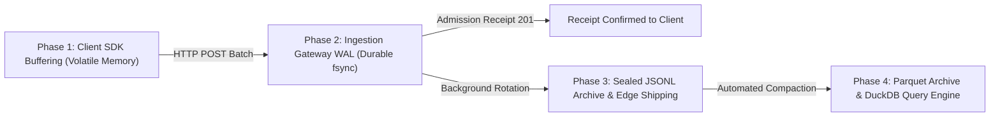

# Skyra LogHub — Logging Pipeline, WAL & Storage Architecture
**Document ID:** `DOC-06-LOGS`  
**Milestone:** Q-04 Canonical Documentation Architecture  
**Status:** Authoritative / Source-Verified  
**Repository:** `skyra-log-hub`  
**Last Verified Baseline:** Canonical Schema v1 / Parquet / DuckDB 1.1

---

## 1. Canonical Log Event Schema (ECS Alignment)

All logging packages and backend pipelines normalize events to the **Canonical Log Schema v1**, aligned with Elastic Common Schema (ECS):

```json
{
  "$schema": "https://loghub.skyra.tech/schemas/v1/canonical-event.json",
  "event_id": "c9b6f123-4567-489a-bcde-123456789abc",
  "timestamp": "2026-11-20T15:00:00.123456Z",
  "severity": "error",
  "service": "billing-service",
  "environment": "production",
  "host": "ip-10-0-2-45.ec2.internal",
  "message": "Payment processing failed due to upstream bank timeout",
  "attributes": {
    "customer_id": "cust_88291",
    "invoice_id": "inv_10294",
    "amount_cents": 4900,
    "currency": "USD"
  },
  "error": {
    "name": "GatewayTimeoutError",
    "message": "ETIMEDOUT connecting to api.bank.internal:443",
    "stack": "GatewayTimeoutError: ETIMEDOUT\n    at Transport.request (/app/dist/transport.js:42:15)"
  },
  "trace_id": "4bf92f3577b34da6a3ce929d0e0e4736",
  "span_id": "00f067aa0ba902b7",
  "correlation_id": "req-98f2-4bc1-aa78",
  "tags": ["payment", "checkout", "retry_exhausted"]
}
```

### 1.1 Normalized Severity Levels
Severities map strictly to six standard levels:
- `trace`: Deep diagnostic telemetry and method entries/exits.
- `debug`: Detailed developer debugging state.
- `info`: Normal operational milestones and health reports.
- `warn`: Non-fatal anomalies, deprecations, or retries.
- `error`: Failed operations or unhandled exceptions impacting a user request.
- `fatal`: System crash, unrecoverable corruption, or service termination.

### 1.2 SDK Transport & Single-Writer Instance Isolation

The client logging libraries (`@skyra/logger-node`, `@skyra/logger-browser`, etc.) enforce strict local filesystem and transport invariants:
- **Storage Contract Path Layout:** `${LOG_ROOT}/${PROJECT_ID}/${ENVIRONMENT}/${SERVICE_NAME}/${INSTANCE_ID}/${YYYY-MM-DD}.part-${PART_INDEX}.jsonl`.
- **Atomic Single-Writer Instance Isolation:** Exclusive ownership lock (`.instance.owner`) using atomic `O_EXCL`, verified PID liveness (`kill(pid, 0)`), and automated stale lock recovery. This strictly prevents concurrent processes from writing to the same segment.
- **UTC Midnight Daily Rotation & Size Rollover:** Monotonic zero-padded 4-digit segment indexing (`.part-0000.jsonl`, `.part-0001.jsonl`) with configurable size thresholds (default 100 MiB) and automatic UTC midnight calendar rotation.
- **Bounded Write Queue & Single-Writer Priority Eviction:** An in-memory queue with backpressure protection. On queue overflow, non-critical logs are dropped with observable metrics, while `error` and `fatal` logs evict older non-critical entries to preserve critical incident telemetry.

---

## 2. Ingestion & Storage Lifecycle

The logging lifecycle progresses through four distinct durability phases:



### Durability Phase Definitions & Data-Loss Boundaries

| Durability Phase | Storage Mechanism | Durability Guarantee | Failure Impact & Recovery |
| :--- | :--- | :--- | :--- |
| **Phase 1: SDK Buffering** | In-memory ring buffer (up to 2,000 events or 5 MB) | **Volatile:** Not guaranteed until accepted by Gateway | Process crash or hard kill (`SIGKILL`) before flush results in buffer loss |
| **Phase 2: Gateway WAL** | Local disk Write-Ahead Log (`.wal`), synchronous `fsync()` | **Guaranteed:** Cryptographic admission receipt returned | Gateway crash recoverable by replaying committed WAL offsets |
| **Phase 3: Sealed Archive** | Sealed JSONL segments, companion `.manifest.json` | **Guaranteed:** WAL preserved until sealed segment and manifest verified | Gateway/Shipper crash restarts from last committed checkpoint |
| **Phase 4: Parquet Archive** | Compressed columnar Parquet files (`ZSTD` / `SNAPPY`) | **Permanent:** Immutable partitioned object store | High-performance SQL queries via DuckDB with pushdown predicates |

---

## 3. Write-Ahead Log (WAL) Durability & Admission Receipts

### 3.1 WAL File Layout & Binary Framing
The Ingestion Gateway writes to segmented append-only WAL files:
```text
/var/loghub/wal/
├── wal-00000001.wal    # Active write segment
├── wal-00000002.wal    # Sealed, awaiting shipping
└── wal-checkpoint.json # Flushed offset tracking
```
Each entry in the `.wal` file is framed:
```text
+-------------------+--------------------+--------------------+-----------------------+
| Magic (4 bytes)   | Length (4 bytes)   | CRC-32 (4 bytes)   | JSON Payload (N bytes)|
| 0x53 0x4B 0x59 0x57| Big-endian Uint32  | IEEE 802.3 CRC32   | UTF-8 JSON Encoded   |
+-------------------+--------------------+--------------------+-----------------------+
```

### 3.2 Fsync Durability Guarantee
1. When a client issues `POST /ingest/v1/logs`, the Gateway appends each event to the active WAL segment.
2. The Gateway explicitly executes `fsync(fd)` (synchronizing both data and file metadata to physical disk).
3. Only after the `fsync` system call returns successfully does the Gateway emit the `200 OK` HTTP response with the admission receipt:
   ```json
   {
     "accepted": 100,
     "batch_id": "b8a5e012-3456-4789-abcd-0123456789ab",
     "receipt": "rcpt_v1_00000001_1763650800_4a9b2c"
   }
   ```
4. If disk write or `fsync` fails (e.g. disk full), the Gateway returns `503 Service Unavailable` (`STORAGE_NOT_READY`), and the client SDK retains events in its retry queue.

---

## 4. Log Shipper & Background Storage Compaction Engine

Storage lifecycle progression separates edge shipping from server-side compaction:

### 4.1 Edge Log Shipper & WAL Rotation
1. **WAL Rotation:** When a WAL segment reaches 64 MB or 5 minutes of age, it is sealed and a new active segment is initialized.
2. **Archive Packaging:** Sealed WAL JSONL entries are formatted into sealed segment files with companion cryptographic `.manifest.json` metadata (SHA-256 digest, record count, timestamp range).
3. **Partition Hierarchy:** Archives are structured by tenant, project, and UTC date:
   ```text
   /var/loghub/archive/
   └── tenant=skyra-corp/
       └── project=payment-prod/
           └── year=2026/
               └── month=11/
                   └── day=20/
                       ├── segment-001.jsonl
                       ├── segment-001.manifest.json
                       ├── segment-002.jsonl
                       └── segment-002.manifest.json
   ```
4. **Metadata Catalog Registration:** The segment is registered in PostgreSQL (`ArchiveSegment`) recording segment file path, event count, byte size, min timestamp, and max timestamp.

### 4.2 Automated Server-Side Background Compaction (BL-06 / Q-06F Hardened)
Automated Parquet materialization runs autonomously within `query-service` via `BackgroundCompactionService`:
1. **Continuous Discovery:** Periodically discovers unmaterialized sealed segments via PostgreSQL `ArchiveSegment` catalog queries or bounded filesystem directory walks.
2. **Manifest Verification:** Verifies companion `.manifest.json` SHA-256 digests, record counts, and schema conformance via `ManifestVerifierService` before materialization.
3. **Hardened Dual-Layer Distributed Locking:** Prevents duplicate conversion using atomic filesystem claim files (`.claims/<segment>.claim.json`) with generational fencing and dedicated-session PostgreSQL advisory locks (`SELECT pg_try_advisory_lock(...)`) bound to explicit `pg.Client` connections with fail-closed enforcement.
4. **Active Heartbeat & Pre-Publication Fencing:** Workers actively extend leases during conversion via heartbeats and verify lease ownership immediately before atomic publication. Stale workers are fenced out with staging files safely removed.
5. **Safe Claim Release:** Claim release verifies unforgeable claim ID and generation, preventing stale workers from deleting newer replacement claims.
6. **Durable Failure Tracking:** Failure records and exponential backoff states are persisted in `.state/compaction-failures.json`, surviving process restarts and capping retries.
7. **Staging & Atomic Rename:** Compaction writes output Parquet to a staging file (`.staging-<id>.parquet`) within the Parquet cache directory, verifies non-empty output and readability, and performs an atomic rename to final destination.
8. **Crash Recovery & Stale Lease Reclaim:** Stale claims past TTL (default 15 minutes) are evicted automatically with monotonic generation increments. Orphaned staging files are purged upon service startup.
9. **Retention & Legal Hold Compliance:** Inspects `ProjectRetention` settings. Segments under active legal hold are safely materialized without risking data loss.
10. **Strict Non-Destructive Invariant:** Background compaction is strictly additive; source JSONL archive files and manifests are never deleted or modified during compaction.

---

## 5. Query Engine Architecture (DuckDB Integration)

The `query-service` utilizes an embedded DuckDB instance to query Parquet files directly without re-indexing into a separate search cluster:
- **Zero-Copy Memory-Mapped Queries:** DuckDB queries the Parquet archives using memory-mapped I/O.
- **Partition & Predicate Pushdown:** The Query Service consults `ArchiveSegment` in PostgreSQL to identify matching Parquet files within the requested time range (`minTimestamp <= :end AND maxTimestamp >= :start`). DuckDB reads only the relevant row groups and columns (e.g., `timestamp`, `severity`, `service`), minimizing I/O overhead.
- **Query Visibility Latency:** Logs become queryable as soon as the active segment is compacted and cataloged (typically 5 to 30 seconds after admission).

