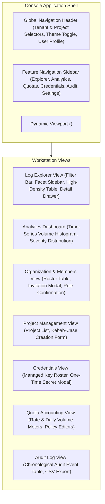

# Skyra LogHub — UI/UX & Angular Console Architecture
**Document ID:** `DOC-07-UI`  
**Milestone:** Q-04 Canonical Documentation Architecture  
**Status:** Authoritative / Source-Verified  
**Repository:** `skyra-log-hub`  
**Last Verified Baseline:** Angular 20.3.35 / Angular CLI 20.3.43 / TypeScript 5.8.3

---

## 1. Angular 20 Application Foundations

The Skyra LogHub Web Console (`apps/console-web`) is built with **Angular 20**, leveraging modern reactive design patterns:
1. **Standalone Components:** 100% of application components, directives, and pipes are standalone (`standalone: true`). `NgModule` is entirely absent.
2. **Signals-First State Architecture:** Component state, form interactions, and service reactivity are managed via Angular Signals (`signal()`, `computed()`, and `effect()`).
3. **Explicit Dependency Injection:** Services are injected using Angular's functional `inject()` API.
4. **Subscription Lifecycle Hardening:** All RxJS subscriptions are bounded using `takeUntilDestroyed(this.destroyRef)` or registered for teardown with `DestroyRef.onDestroy()`. Components never leave unbounded subscriptions active upon unmount.
5. **AOT Build Performance:** Initial bundle size is strictly governed (production build yields `580.00 kB` uncompressed, `137.35 kB` transfer size).

---

## 2. Skyra Platform Integration & Design System

### 2.1 Web Components Architecture
Skyra LogHub standardizes on the **Skyra Platform Design System** as its exclusive UI component library:
- 16 `@skyra-tech-platform/*` Web Component packages are imported and registered.
- All packages are sourced from local, immutable npm tarballs (`artifacts/platform-packages/*.tgz`).
- Custom elements are enabled across Angular components via `CUSTOM_ELEMENTS_SCHEMA`.
- **Third-Party UI Library Policy:** Competing third-party component libraries (such as Angular Material, Bootstrap, Tailwind, PrimeNG, or Ant Design) are strictly prohibited.

### 2.2 Shared Angular Wrappers (`shared/ui/`)
To preserve Angular developer ergonomics while maintaining platform design compliance, LogHub encapsulates raw web components into typed Angular signal wrappers:
- `SkyraButtonComponent` $\rightarrow$ Wraps `<skyra-tech-button>` with typed variants (`primary`, `secondary`, `destructive`).
- `SkyraBadgeComponent` $\rightarrow$ Wraps `<skyra-tech-badge>` with ECS severity mapping.
- `SkyraInputComponent` $\rightarrow$ Wraps `<skyra-tech-input>` with signal value binding.
- `SkyraSelectComponent` $\rightarrow$ Wraps `<skyra-tech-select>` for tenant and project dropdowns.

### 2.3 Design Tokens & Theme Governance
All visual styling strictly adheres to Skyra Platform design tokens via CSS Custom Properties:
- Surface colors: `var(--skyra-bg-primary)`, `var(--skyra-surface-1)`, `var(--skyra-surface-2)`.
- Brand & accent: `var(--skyra-brand-primary)`, `var(--skyra-brand-accent)`.
- Severity colors: `var(--skyra-severity-error)`, `var(--skyra-severity-warn)`, `var(--skyra-severity-info)`.
- The `ThemeService` reactively manages Light, Dark, and System theme preferences, synchronizing `data-theme` attributes on the document root and listening to `prefers-color-scheme` media queries with registered `DestroyRef` cleanup.
- Automated governance (`pnpm governance:check`) scans 129 source files to ensure zero unapproved, hard-coded brand hex codes exist in component styles.

---

## 3. High-Density Workstation Layout & Features

---

## 4. Key Workstation UX Capabilities

### 4.1 Log Explorer & Detail Drawer
- **Filter Bar:** Real-time query input with search debouncing, syntax validation, and preset time range selectors (15m, 1h, 24h, 7d, Custom).
- **Facet Aggregations:** Left-hand breakdown showing occurrence counts by service, level, and host. Clicking a facet automatically appends the filter to the active query.
- **High-Density Table:** Monospace workstation table optimized for log scanning, with millisecond-precision timestamps, normalized ECS severity badges, and keyboard arrow navigation.
- **Detail Drawer:** Slide-out drawer displaying full structured JSON event data, copyable trace IDs, and stack traces.
- **Stream Exports:** Filtered search results can be exported as CSV or JSON using the reusable `triggerBlobDownload` transport utility, which automatically revokes memory ObjectURLs upon completion.

### 4.2 Credential Generation & One-Time Secret Revelation
- When a project API key is provisioned, the backend returns the plaintext secret key `sk_live_...` exactly once.
- The UI presents a modal dialog with the secret obscured by default, an unmask toggle, an immediate one-click copy button, and an explicit warning that the secret cannot be recovered once the modal is closed.

### 4.3 Accessible Data Visualizations
- All charts in the Analytics module provide an accessible tabular toggle (`TSC-3`), allowing keyboard-only and screen-reader users to inspect raw numerical data in standard HTML tables rather than relying on canvas or SVG coordinates.

