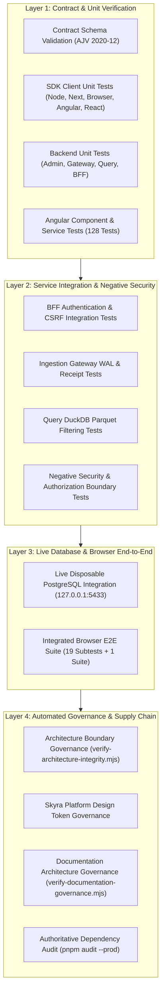

# Skyra LogHub — Testing Architecture & Quality Assurance
**Document ID:** `DOC-08-TEST`  
**Milestone:** Q-04 Canonical Documentation Architecture  
**Status:** Authoritative / Source-Verified  
**Repository:** `skyra-log-hub`  
**Last Verified Baseline:** Node.js v24.14.0 & v22.14.0 / TypeScript 5.8.3 / pnpm 10.4.1

---

## 1. Testing Architecture & Verification Hierarchy

Skyra LogHub implements a multi-tier testing strategy ensuring functionality, contract parity, security boundaries, and runtime compatibility:



---

## 2. Mandatory Test Reconciliation (Q04-B1 Authoritative Results)

During Milestone Q-04 reconciliation, test execution counts across all 12 monorepo targets were independently audited from the authoritative execution of `pnpm test` under Node.js v24.14.0 (run task-1086):

| Target Application / Package | Test Runner / Command | Tests | Pass | Fail | Skip | Verdict |
| :--- | :--- | :---: | :---: | :---: | :---: | :---: |
| **`@skyra/shared-contracts`** | `node --experimental-strip-types --test tests/contracts/**/*.test.ts` | 66 | 66 | 0 | 0 | **PASS** |
| **`@skyra/logger-node`** | `node --experimental-strip-types --test packages/logger-node/tests/**/*.test.ts` | 103 | 103 | 0 | 0 | **PASS** |
| **`@skyra/logger-nestjs`** | `pnpm --filter @skyra/logger-nestjs test` | 46 | 46 | 0 | 0 | **PASS** |
| **`@skyra/logger-next`** | `pnpm --filter @skyra/logger-next test` | 47 | 47 | 0 | 0 | **PASS** |
| **`@skyra/logger-browser`** | `pnpm --filter @skyra/logger-browser test` | 40 | 40 | 0 | 0 | **PASS** |
| **`@skyra/logger-angular`** | `pnpm --filter @skyra/logger-angular test` | 8 | 8 | 0 | 0 | **PASS** |
| **`@skyra/logger-react`** | `pnpm --filter @skyra/logger-react test` | 6 | 6 | 0 | 0 | **PASS** |
| **`@skyra/ingestion-gateway`** | `pnpm --filter @skyra/ingestion-gateway test` | 104 | 103 | 0 | 1* | **PASS** |
| **`@skyra/query-service`** | `pnpm --filter @skyra/query-service test` | 233 | 232 | 0 | 1* | **PASS** |
| **`@skyra/admin-service`** | `pnpm --filter @skyra/admin-service test` | 99 | 99 | 0 | 0 | **PASS** |
| **`@skyra/console-bff`** | `pnpm --filter @skyra/console-bff test` | 117 | 117 | 0 | 0 | **PASS** |
| **`@skyra/console-web`** | `pnpm --filter @skyra/console-web test` | 128 | 128 | 0 | 0 | **PASS** |
| **Authoritative Full Suite Totals** | `pnpm test` | **997** | **995** | **0** | **2** | **PASS** |

*\*Note on Skipped Tests: The 2 intentionally skipped tests represent live PostgreSQL integration tests that safely skip when offline if live database environment flags are not explicitly provided.*

---

## 3. Database Safety Boundaries & Isolation

### 3.1 Protected Database Boundary
- **Instance:** `127.0.0.1:5432 / skyra_loghub_dev`
- **Safety Rule:** **ZERO connections, ZERO writes, ZERO migrations.**
- Verified by SHA-256 baseline snapshot (`90f73c6f2bc6bce568974e27472fd652505e3034284ff4a9883104b1fd02a6ff`). Any test or process attempting to access port 5432 is strictly prohibited.

### 3.2 Disposable Validation Database
- **Instance:** `127.0.0.1:5433 / skyra_loghub_disposable_validation`
- **Ownership Marker:** Cluster ID `26d25080-7655-4147-b05a-512ad359e14f`.
- Integration suites execute exclusively against this disposable instance after verifying exact target ownership.

### 3.3 Storage Lifecycle & Background Compaction Verification (Milestones Q-06E & Q-06F)
- **Unit & Integration Suite (`apps/query-service/tests/integration/background-compaction.test.ts`):** 18 deterministic tests validating normal compaction, idempotency, concurrent claims, stale lease recovery, companion manifest rejection, staging cleanup, exponential retry backoff, legal hold preservation, hybrid query correctness, nondestructive invariants, heartbeat lease renewal, generational fencing takeover, pre-publication fencing verification, fail-closed database coordination, and durable failure tracking across restarts.
- **Live Persistence Suite (`tests/storage/live-compaction.test.mjs`):** Disposable PostgreSQL 17 + DuckDB integration verifying target guard validation, PostgreSQL discovery, dedicated-session advisory lock serialization (`pg_try_advisory_lock`), separate-filesystem multi-worker concurrency, heartbeat renewal over live DB session, retention policy inspection, Parquet materialization, and zero-deletion safety.

---

## 4. Multi-Runtime & Framework Compatibility Matrix

| Runtime / Framework | Tested Baseline | Status | Key Verification Scope |
| :--- | :--- | :--- | :--- |
| **Node.js 24** | v24.14.0 | **Primary Verified** | Complete workspace test suite, typecheck, production builds |
| **Node.js 22** | v22.14.0 | **Verified Compatible** | Full regression matrix executed in Q-02B / Q-02C |
| **NestJS** | v11.2.11 | **Verified Compatible** | Admin, BFF, Gateway, Query services; DI lifecycle |
| **Fastify** | v5.12.8 | **Verified Compatible** | HTTP routing, hooks, cookie plugin, middie middleware |
| **Angular** | v20.3.35 | **Verified Compatible** | Standalone components, signals, AOT compilation, Vitest suite |
| **Angular CLI / Build**| v20.3.43 | **Verified Compatible** | Production build bundle optimization (`580 kB`) |
| **TypeScript** | v5.8.3 | **Verified Compatible** | Strict mode across root, apps, packages (0 type errors) |

---

## 5. Automated Quality & Governance Commands

Developers and CI systems enforce quality through the following standard npm scripts:

```bash
# Run full unit and integration test suite across all 12 workspace targets
pnpm test

# Full workspace TypeScript compilation check
pnpm typecheck

# Angular Console production AOT build
pnpm --filter console-web build

# Architectural boundary verification (6 integrity gates)
pnpm architecture:check

# Skyra Platform design token & branding compliance check
pnpm governance:check

# Documentation architecture & link integrity governance
pnpm docs:check

# Production dependency security vulnerability audit
pnpm audit --prod
```

---

## 6. Milestone History & Historical Evidence Preservation

| Milestone | Scope & Core Deliverable | Technical Result | Authoritative Preservation Verdict |
| :--- | :--- | :---: | :---: |
| **DEV-013** | Session security & durable PostgreSQL persistence | Functional PASS | Historical evidence intact |
| **DEV-018** | End-to-end integration & evidence lockdown | Technical PASS | **FAIL — DEV-018 preservation evidence unrecoverable** |
| **Q-01** | Initial repository & engineering audit | Audit Complete | PASS |
| **Q-02A** | Critical dependency remediation (NestJS 11, Fastify 5, Angular 20) | Security Pass | PASS |
| **Q-02B** | Independent security verification & Node.js 22 testing | Zero Vulns | PASS |
| **Q-02C** | Final security closure (Node 24 matrix & Browser E2E) | Full Suite Pass | PASS |
| **Q-03** | Architecture, reusability & lifecycle hardening | Architecture Pass | PASS |
| **Q-04** | Canonical documentation consolidation & repository cleanup | Docs Gov Pass | **PASS** |
| **Q-05** | Continuous Integration & Automated Engineering Quality Enforcement | CI Gates Implemented & Locally Verified | **CONDITIONAL** (Pending hosted GitHub Actions run) |

### Absolute Evidence Preservation Invariant
> [!IMPORTANT]
> The historical acceptance verdict for **DEV-018** remains permanently:
> **`FAIL — DEV-018 preservation evidence unrecoverable`**
> Success in subsequent milestones (Q-01 through Q-05) certifies contemporary technical quality, architecture, and security, but does **not** alter, waive, or retroactively resolve the original DEV-018 historical preservation failure. The DEV-018 baseline manifest (`e04cac412...`) and the four historical DEV-013 evidence files remain permanently preserved and byte-identical.

---

## 7. Automated Continuous Integration Quality Gates (Milestone Q-05)

The automated quality pipeline defined in `.github/workflows/sdk-verification.yml` executes on every pull request and push to primary branches:

| Pipeline Job | Key Validation Steps & Commands | Target Runtime / Environment | Success Criteria |
| :--- | :--- | :--- | :--- |
| **`static-quality-and-governance`** | `pnpm docs:check`<br/>`pnpm architecture:check`<br/>`pnpm governance:check`<br/>`pnpm check:schema-sync`<br/>`pnpm audit --prod --json` | Node.js 24.x on Ubuntu Latest | 0 governance violations, 0 production vulnerabilities |
| **`typecheck-and-compilation`** | `pnpm typecheck`<br/>`pnpm build`<br/>`pnpm --filter @skyra/log-shipper build` | Node.js 24.x on Ubuntu Latest | 0 type errors across workspace, clean AOT & NestJS builds |
| **`test-suites`** | `pnpm test:contracts`<br/>`pnpm test:node`<br/>`pnpm test:nestjs`<br/>`pnpm test:next`<br/>`pnpm test:browser`<br/>`pnpm test:angular`<br/>`pnpm test:react`<br/>`pnpm test:gateway`<br/>`pnpm test:query`<br/>`pnpm test:admin`<br/>`pnpm test:bff`<br/>`pnpm test:console`<br/>Target guard unit tests | Node.js 24.x (Primary)<br/>Node.js 22.x (Compatibility) | 100% pass across all 995 unit/integration tests |
| **`python-sdk-matrix`** | `python -m unittest discover -s packages/logger-python/tests`<br/>`python -m build packages/logger-python` | Python 3.10, 3.11, 3.12 on Linux, Windows, macOS | All 61 tests passing across 9 matrix combinations |
| **`postgresql-integration`** | `node scripts/ci-init-disposable-postgres.mjs`<br/>`node --test tests/admin/isolated-target.test.mjs`<br/>`pnpm test:compaction:persistence` | PostgreSQL 17 on disposable port 5433 | Zero touch to port 5432; target guards verified against live container; compaction advisory locks, retention inspection & Parquet materialization pass |
| **`browser-e2e`** | `node tests/e2e/real-browser.test.mjs` | Headless Google Chrome Stable via CDP | All browser ingestion, batching, and error assertions passed |
| **`isolated-distribution-check`** | `pnpm pack` (all packages)<br/>`python -m build`<br/>`verify_isolated_browser_consumer.mjs`<br/>`verify_isolated_python_consumer.py` | Isolated consumer environments | Clean installation & execution from distribution tarballs |
| **`final-quality-gate`** | Aggregate status evaluation (`needs.*.result`) | Ubuntu Latest | Fails closed if any upstream required job fails or is cancelled |
